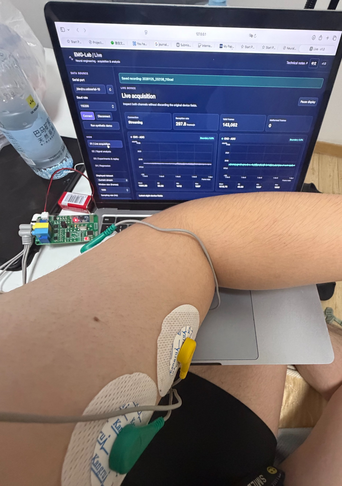
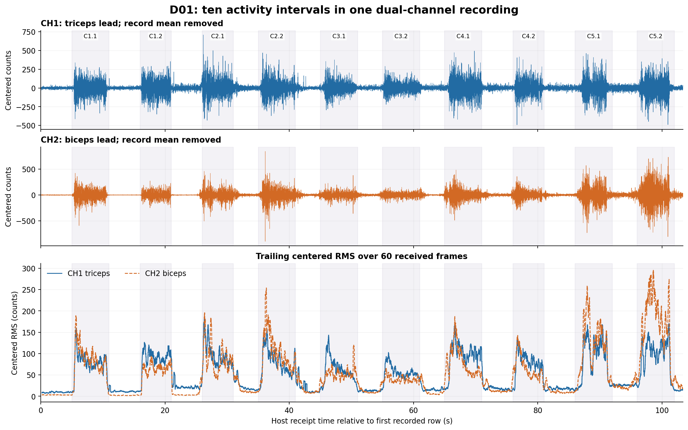

# EMG-Lab

### Neural Engineering and Biosignal Analysis Toolkit

**Jincheng Li · Independent engineering project · November 2026 · v1.1**

[中文说明](README.zh-CN.md) · [Quick start](docs/QUICKSTART.md) · [Illustrated hardware guide](docs/HARDWARE_GUIDE.md) · [Technical report](reports/TECHNICAL_REPORT.md)

The seller told me I needed Windows to use this two-channel surface EMG kit. I had a MacBook Pro. The USB receiver sent eight numbers per frame over a serial port, and the vendor documented what they meant. That gave me a way to read the device on my Mac.

I used AI coding tools to build a local Python service that reads the receiver and a browser interface that shows both channels live. I connected the hardware, checked what happened when the leads were left floating, and used the app to record my own biceps and triceps. The five original recordings are included here, along with the code I used to analyze them.

The browser interface and Python service are designed for macOS and Windows. I tested the acquisition setup on macOS. I haven’t tested the receiver on Windows yet, for the same reason I built EMG-Lab in the first place. I don’t own a Windows PC.

<p align="center"></p>

*Original project photograph. It documents the actual setup used; it is not a validated electrode-placement template. [Photo context](docs/HARDWARE_GUIDE.md).* 

## What is included

| Component | What it does | Where to look |
| --- | --- | --- |
| Acquisition application | Reads the eight-field serial protocol, plots both channels, monitors parsing and boundary-code occupancy | [server.py](server.py), [web/](web/) |
| Recording and replay | Saves received device fields, host receipt times and event metadata; imports and scans CSV files | [Quick start](docs/QUICKSTART.md) |
| Numerical analysis | Mean removal, optional filters, sliding RMS, descriptive statistics, FFT, Welch PSD, ACF and CCF | [Methods](docs/METHODS.md) |
| Regression demonstration | Fits OLS to two RMS features and evaluates held-out trials or chronological windows | [Synthetic example](examples/synthetic_labeled.csv) |
| Real recordings | Five original CSV files, 71,287 received frames, with a data dictionary and source hashes | [Data documentation](data/README.md) |
| Reproducible report | Recreates descriptive tables and figures from the original CSV files | [Technical report](reports/TECHNICAL_REPORT.md), [analysis script](scripts/analyze_recordings.py) |
| Interactive notes | Six bilingual chapters, 25 modules, self-contained HTML demonstrations | [docs/index.html](docs/index.html) |
| Engineering record | Architecture, protocol, limitations, test evidence and AI-assisted contribution statement | [Architecture](docs/ARCHITECTURE.md), [verification](TEST_STATUS.md), [contributions](docs/AI_AND_CONTRIBUTIONS.md) |

## Try the application

On **macOS**, open Terminal in the folder containing `server.py` and run the following command.

```bash
bash run.command
```

The launcher reuses `~/emg-lab-venv` if available, otherwise creates a local `.venv`, and installs missing application dependencies. It opens **http://127.0.0.1:8765/**. Python 3.10 or newer is the documented baseline. Initial dependency installation requires internet access; ordinary acquisition, replay, and analysis run locally.

On **Windows**, follow the [PowerShell instructions](docs/QUICKSTART.md#windows) to start the same local server. You can try the synthetic demo or replay a recording before connecting a receiver.

**Without hardware:** choose **Run synthetic demo**. To inspect an actual included recording, open **03 / Experiments & replay**, import `data/raw/20261125_232138_110cad.csv`, then open **02 / Signal analysis**. Leave the sampling-rate field blank. The display uses frame index and cycles/frame until a rate is supplied.

**With the existing receiver:** close other serial programs, refresh the serial-port list, choose the actual port, and use **115200 baud**. The author's Mac exposed `/dev/cu.usbserial-10`; another computer can use a different name. The [illustrated guide](docs/HARDWARE_GUIDE.md) explains the hardware path, initial checks and historical setup. This prototype has no stimulation function, and its software tests do not establish the module's electrical safety for human use.

Stop the application with **Control+C** in Terminal. If the HTTP port is occupied, run `bash run.command --port 8766`.

## What the experiments show

The dataset preserves the development process, including poor-quality recordings.

1. **Bench troubleshooting.** Boundary-code occupancy followed an attached floating cable between channels. The two saved floating-input recordings show severe saturation-like behavior and narrowband interference.
2. **Single-channel exploration.** The first attempted biceps session was heavily contaminated. A later session, after changing the reference location and contraction effort, had no 0-or-4095 codes but retained substantial narrowband energy. Several variables changed together, so this does not isolate an electrode-location effect.
3. **Dual-channel recording.** The final session contains **30,835 frames over 103.37 seconds of host receipt time**. CH1 was assigned to triceps and CH2 to biceps. Five intended activation conditions were each performed twice. A documented retrospective activity rule identifies ten activity intervals. Both recorded channels had **0% occupancy at the provisional boundary codes 0 and 4095**.



*Recomputed from the included CSV. Time is relative host receipt time. Activity boundaries were reconstructed after acquisition, not recorded by a synchronized event device.*

| Intended condition | Repetitions | CH1 triceps: mean segment-centered RMS | CH2 biceps: mean segment-centered RMS |
| --- | ---: | ---: | ---: |
| Neutral arm, both muscles | 2 | 87.23 counts | 78.57 counts |
| Extended elbow, both muscles | 2 | 92.85 counts | 104.23 counts |
| Extended elbow, triceps emphasis | 2 | 63.00 counts | 47.34 counts |
| Flexed elbow, both muscles | 2 | 91.82 counts | 79.30 counts |
| Flexed elbow, biceps emphasis | 2 | 99.77 counts | 154.07 counts |

The table averages the two segment RMS values in each condition. These are descriptive results from one self-recorded session. The intended selective actions do not prove selective muscle recruitment; channel gain, electrode placement, motion and crosstalk were not independently controlled. Raw count amplitudes cannot be converted into muscle force or compared as calibrated force between muscles. See the [full report](reports/TECHNICAL_REPORT.md) for boundaries, formulas, quality checks and limitations.

## Reproduce the analysis

Use a Python environment with the analysis dependencies:

```bash
python3 -m venv .venv
source .venv/bin/activate
python -m pip install -r requirements-analysis.txt
python scripts/analyze_recordings.py
```

The script reads `data/raw/`, writes derived tables to `data/derived/`, and regenerates report figures and the numerical appendix. It does not alter the source CSV files. File hashes and parameters make the calculations traceable. [Data provenance and dictionary](data/README.md).

To run the software tests in the same environment:

```bash
python -m unittest discover -s tests -v
```

## Six interactive chapters

| Chapter | Modules | Main questions |
| --- | ---: | --- |
| Neural Electrophysiology | 4 | How do ion gradients, membrane potentials and action potentials relate? |
| Neuromuscular Mechanisms | 3 | How does neural activation trigger muscle contraction, and where does ATP enter? |
| Biosignal Acquisition | 5 | What do electrodes, differential measurement, amplification, filtering and ADC do? |
| Hardware–Software Interface | 3 | How do device fields become structured records on a computer? |
| Computational EMG Analysis | 7 | What do amplitude features, spectra, correlations and regression measure? |
| Experimental Studies | 3 | How are experiments designed, checked and interpreted? |

Open `docs/index.html` directly in a browser for the offline notes. The language toggle switches between English and Chinese. Educational animations and simulated signals are identified separately from real recordings. GitHub displays the HTML source by default; enabling GitHub Pages for the `docs/` folder makes the notes interactive online. The local Python acquisition application still runs on the user's computer.

## Engineering decisions

- Preserve all eight received fields and the original valid-frame CSV values; analysis settings do not overwrite recordings.
- Treat the two ADC-like fields as **manufacturer-filtered integer counts**, with no established conversion to electrode-level millivolts.
- Keep **received frames/s** separate from the unknown hardware sample clock. Spectra remain in cycles/frame by default.
- Distinguish live hardware, imported files, and synthetic examples. A synthetic label alone does not establish a file's sampling rate.
- Report malformed frames, but do not infer wireless packet-loss rate from a host-generated counter.
- Keep physiological observations, synthetic algorithm checks and software verification as separate evidence.

## Author's contribution

Jincheng Li selected and assembled the commercial acquisition setup, interpreted the published protocol, defined the macOS workflow, directed AI-assisted development of the Python backend and browser frontend, carried out hardware troubleshooting and self-recorded experiments, and developed the accompanying technical notes and analysis report with AI assistance. This project does not claim original PCB design, custom MCU firmware, or a new EMG algorithm. [Detailed contribution statement](docs/AI_AND_CONTRIBUTIONS.md).

## Documentation map

| Need | File |
| --- | --- |
| Start the app or replay data | [QUICKSTART.md](docs/QUICKSTART.md) |
| See the actual hardware and connections | [HARDWARE_GUIDE.md](docs/HARDWARE_GUIDE.md) |
| Understand the serial fields | [PROTOCOL.md](docs/PROTOCOL.md) |
| Inspect system design or HTTP endpoints | [ARCHITECTURE.md](docs/ARCHITECTURE.md), [API.md](docs/API.md) |
| Understand calculations | [METHODS.md](docs/METHODS.md) |
| Read experimental evidence | [TECHNICAL_REPORT.md](reports/TECHNICAL_REPORT.md), [RESULTS.md](reports/RESULTS.md) |
| Inspect validation limits | [TEST_STATUS.md](TEST_STATUS.md), [KNOWN_LIMITATIONS.md](docs/KNOWN_LIMITATIONS.md) |

Third-party sources are listed in [References](docs/REFERENCES.md). Software, recordings, documentation and original photographs have separate provenance described in [Attribution and rights](ATTRIBUTION.md). Version changes are listed in [CHANGELOG.md](CHANGELOG.md).
