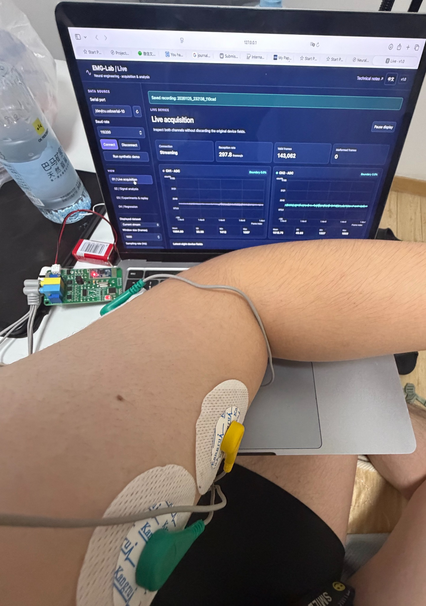
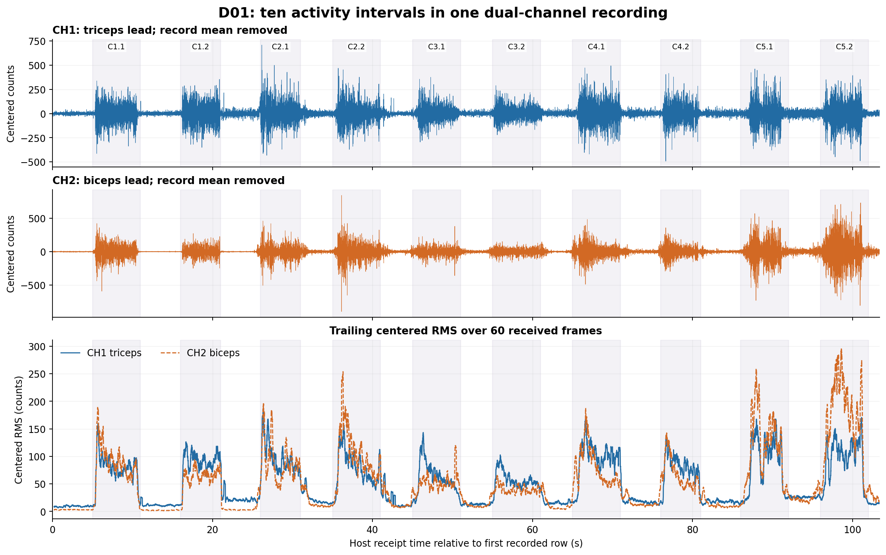

# EMG-Lab

## 神经工程与生物电信号采集分析工具包

**李锦承 Jincheng Li · 独立工程项目 · 2026 年 11 月 · v1.1**

[English](README.md) · [操作说明](docs/QUICKSTART.md) · [实物图解](docs/HARDWARE_GUIDE.md) · [技术报告](reports/TECHNICAL_REPORT.md)

店家告诉我，这套双通道表面肌电设备得用 Windows。我手头只有一台 MacBook Pro。翻了设备说明，我发现 USB 接收器会通过串口逐帧发出八个数字，文档里也列出了每个数字的含义。这样一来，我就有办法在 Mac 上自己读它了。

我用 AI 辅助编程（vibe coding）做了一个本地应用。Python 负责从接收器读数，浏览器里的网页负责实时显示两路波形。我亲自接上设备，先看导联悬空时会出现什么信号，再用它记录自己二头肌和三头肌发力时的变化。仓库里保留了这一路的五份原始记录和分析代码。

这套网页界面和 Python 服务按 macOS、Windows 两个平台设计。我在 Mac 上完成了实机采集。Windows 上还没测，原因嘛，和我当初写这个程序的原因一样——我没有 Windows 电脑。

<p align="center"></p>

*作者提供的真实实验照片。照片记录当时的装配与操作，不是经过验证的通用电极放置标准。*

## 从哪里开始

| 你想做什么 | 打开什么 |
| --- | --- |
| 看项目整体做了什么 | [英文项目首页](README.md) |
| 启动实时采集软件 | macOS 在项目目录运行 `bash run.command`，Windows 见 [PowerShell 启动步骤](docs/QUICKSTART.md#windows) |
| 没有设备也先体验 | 启动后点击 **Run synthetic demo** |
| 回放现成的真实数据 | 在 **Experiments & replay** 导入 `data/raw/` 里的 CSV |
| 看可交互的学习笔记 | 用浏览器打开 `docs/index.html` |
| 看五种动作的分析 | [技术报告](reports/TECHNICAL_REPORT.md) |
| 看接线照片和按钮位置 | [实物图解](docs/HARDWARE_GUIDE.md)、[快速使用](docs/QUICKSTART.md) |

## 已实现的内容

- **硬件接入：**通过串口接收商用单片机模块的数据；解析双通道共八个整数；处理分段到达的字节与不完整帧。
- **实时界面：**双通道波形、接收帧率、有效帧和格式错误计数、边界码占比、均值与标准差。
- **实验记录：**CSV 保存设备字段，JSON 保存实验名称、设置与主机事件标记；支持导入与历史数据回放。
- **数值分析：**去窗口均值、数字滤波、滑动 RMS、FFT、Welch PSD、自相关、互相关和 OLS 回归演示。
- **可复算结果：**五份原始 CSV、分析脚本、数据字典、派生表格、实验图和完整技术报告。
- **交互笔记：**六章、25 个模块，覆盖电生理、神经肌肉机制、信号采集、硬件接口、统计分析和实验方法，支持中英文切换。

## 实验记录的核心结果

五份文件共 **71,287 帧**。最后一份双通道记录包含 **30,835 帧**，按主机收到数据的时间计算约 **103.37 秒**。

最后这次的通道分配是 **CH1 三头肌、CH2 二头肌**。作者按五种意图动作各做了连续两次，动作间休息。报告用明确写出的回顾性规则，找到了十个活动区间。两通道在这份文件中均未出现 0 或 4095 边界码。



这些结果支持“软件能接收并保存真实设备数据，数据中存在与动作时段对应的幅度变化”。它们不能单独证明某块肌肉完全独立发力，也不能将两个通道的 ADC 数值直接当作力量大小。原始数据中没有独立力传感器、精确动作事件文件或硬件采样时钟。

前面两份悬空导联数据和第一份质量较差的身体记录也保留了下来。报告说明如何从边界码、波形和频谱识别问题，而不是只展示最后最好看的一张图。

## 软件怎么打开

以下是在 macOS 上的操作。Windows 用户可按[快速指南中的 PowerShell 步骤](docs/QUICKSTART.md#windows)启动本地服务。

1. 解压后进入 **EMG-Lab** 文件夹。
2. 打开终端，输入 `bash `，注意末尾有空格。
3. 把 `run.command` 拖入终端，回车。
4. 浏览器打开 `http://127.0.0.1:8765/`。

启动脚本优先复用 `~/emg-lab-venv`，否则使用或创建项目内的 `.venv`。需要 Python 3.10 或以上；首次缺依赖时会安装依赖。之后本地接收和分析不需要云服务。

作者机器上接收器名称是 `/dev/cu.usbserial-10`，波特率为 `115200`。采样率默认留空，显示 **Unknown / 未知**。接收帧率不是已经验证的硬件采样率。

**Window size** 在左侧栏；**Remove window mean**、**Digital filter**、**RMS window** 在 **02 / Signal analysis** 页顶部。完整设置表见[快速使用](docs/QUICKSTART.md)。

## 如何复算

在项目文件夹中运行：

```bash
python3 -m venv .venv
source .venv/bin/activate
python -m pip install -r requirements-analysis.txt
python scripts/analyze_recordings.py
```

原始 CSV 保持不变，输出写入 `data/derived/` 与 `reports/`。自动化软件检查：

```bash
python -m unittest discover -s tests -v
```

## 项目分工

我使用商用采集板和原厂固件，负责硬件接入、排障、记录和分析，并主导 AI 辅助的软件开发。具体分工见[贡献说明](docs/AI_AND_CONTRIBUTIONS.md)。

## 参考电极位置怎么记录

实验中实际尝试过手腕、膝盖与额头作为红色参考电极的位置。报告保留这些操作事实。膝盖位置那次同时改变了收缩力度，后续双通道实验也改变了其他条件，因此不能据此得出“膝盖或额头普遍更好”的结论。红色导联的角色以该型号厂家的接线定义为准。

这是工程学习与探索性记录项目。软件不提供刺激功能；采集装置和刺激装置保持独立，不同时连接人体。电气安全、采样率、增益和物理量标定仍需独立验证。
