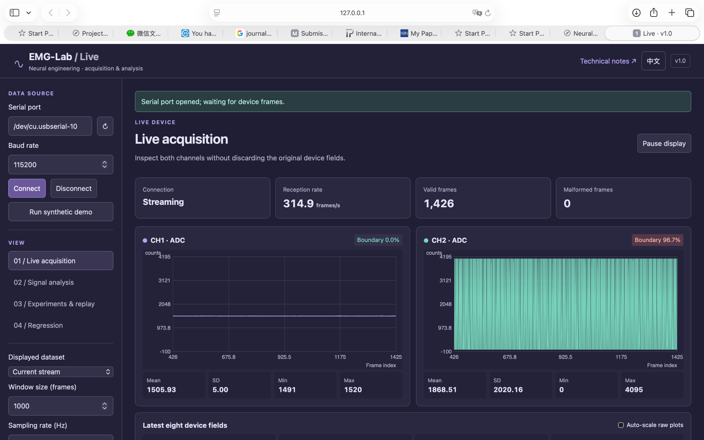
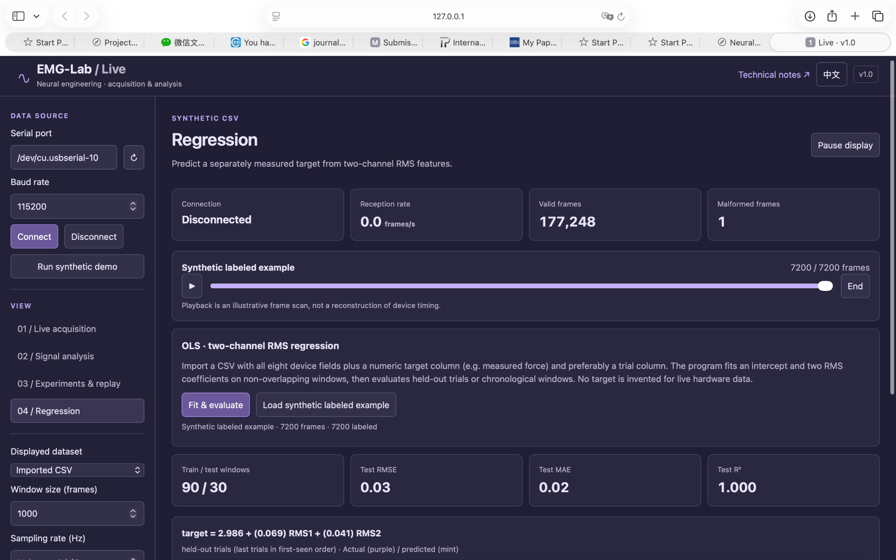

# Verification status — v1.1

Date: 25 November 2026. These records distinguish software checks from the author's physical-device observations. The v1.1 package has not yet been rerun on the author's Mac after the small fixes below.

## 1. Checks run on the packaged software

| Check | Result | Scope |
| --- | --- | --- |
| Python unit and HTTP integration suite | **13 tests passed** | `python3 -m unittest discover -s tests -v` |
| Python compilation | Passed | `python3 -m py_compile server.py` |
| JavaScript syntax | Passed | `node --check web/app.js` |
| macOS launcher shell syntax | Passed | `bash -n run.command`; not a new Mac launch test |
| Five supplied device CSV files | All imported and analyzed | 9,387; 9,572; 10,817; 10,676; 30,835 rows, respectively; sampling-rate basis stayed `unknown` |
| Large frame-index tick labels | Passed focused numerical check | Nearby ticks remain distinct at frame indices above 100,000 |

The suite covers valid and malformed ASCII frames, split serial reads, rolling RMS, variance, known-frequency FFT/PSD, ACF and CCF lag direction, a filter's response and unknown-rate guard, sampling-rate labels, CSV import, synthetic OLS, recording, and analysis. The HTTP integration test starts a temporary loopback server and exercises the UI document routes, demo acquisition, recording, marker/JSON saving, CSV download/import, analysis, built-in example regression, disconnect, and rejection of an unrelated web origin. It does not emulate the physical amplifier or wireless receiver.

Test environment: Python **3.12.14**, NumPy **2.3.5**, SciPy **1.17.0**, Matplotlib **3.10.8**, Node.js **24.22.3**. `pyserial` was not installed in this packaging environment; tests did not open a hardware port. The app's launcher installs missing runtime dependencies from `requirements.txt` on the target computer. Minimum dependency ranges are not a claim that every possible version combination has been tested.

The included GitHub Actions workflow targets Python 3.12 and 3.13. It has been prepared for upload; no hosted Actions run is claimed here. It uses [GitHub's Python workflow guidance](https://docs.github.com/en/actions/tutorials/build-and-test-code/python) and the [official setup-python action](https://github.com/actions/setup-python).

## 2. Physical-device evidence from the author's original v1.0 Mac session

The author operated the commercial board through its USB serial receiver at `/dev/cu.usbserial-10`, 115200 baud. Terminal output, submitted screenshots, and saved CSV files provide the following evidence:

- Serial data acquisition and dual-channel live plotting operated on the Mac.
- The floating-lead comparison changed which channel showed a high fraction of 0/4095 boundary codes.
- Recording produced CSV files that were subsequently imported for offline waveform/statistical analysis. The supplied real files are bundled in [`data/raw/`](data/raw/).
- Historical replay and analysis were exercised with the device disconnected.
- Unlabeled device CSV data did not produce a fabricated regression target.
- The separately labeled synthetic example ran through regression in the Mac UI.

**Figure 1.** Original v1.0 live acquisition screenshot. This is a floating-input/interference example; its large waveform is not presented as muscle activity. The interface reports a reception rate, not an independently measured sampling clock.

**Figure 2.** Original v1.0 regression screen using the built-in synthetic example. It demonstrates the software path, not biological predictive accuracy.

The current package reproduced the synthetic example's 90 training and 30 held-out windows: RMSE **0.02760**, MAE **0.02346**, R² **0.999568** in the example's arbitrary target units. The high fit follows a deliberately simple data-generating relationship; a display rounded to `1.000` should not be described as perfect real-world performance.

## 3. Corrections in v1.1

1. **Imported synthetic provenance no longer implies a 300 Hz clock.** An arbitrary CSV with `source_kind=synthetic` stays at unknown sampling rate until a user supplies one. Only the built-in generator and the built-in example use their known 300 Hz rate automatically. This is covered by a regression test.
2. Large frame indices use tick precision based on tick spacing, preventing several distinct frame ticks from displaying the same rounded label.
3. RMS, amplitude-spectrum and PSD plots use a nonnegative vertical axis.
4. The temporary connection banner changes from “waiting” to “receiving” once device frames arrive.

The serial framing, eight recorded device fields, raw CSV contents, and numerical analysis definitions are unchanged. The original eleven tests passed before the fixes; the expanded thirteen-test suite passed after them.

## 4. Limits of the evidence

- The new v1.1 UI has a syntax check, but no new physical-Mac or browser visual acceptance session is claimed. An optional local Playwright attempt could not launch because this environment has no installed browser binary; no new browser screenshot was produced. The screenshots are labeled v1.0 evidence.
- ADC physical resolution, gain, input-referred voltage calibration, filter response, uniform device sample timing and cross-channel timing have not been independently established.
- No device-side sequence number is exposed in the published eight-field protocol. A clean parser run cannot establish zero wireless packet loss.
- The dataset has no supplied device-synchronized event file. Trial boundaries reconstructed for the report are exploratory annotations.
- The self-recorded sessions support a small engineering case study. They do not establish clinical accuracy, independent-participant generalization, calibrated force prediction or isolation of individual motor units.
- Software tests and a battery-powered/wireless setup do not certify the electrical safety of the commercial acquisition hardware.

See the [technical report](reports/TECHNICAL_REPORT.md) for the data analysis and [API reference](docs/API.md) for the exact software behavior.
