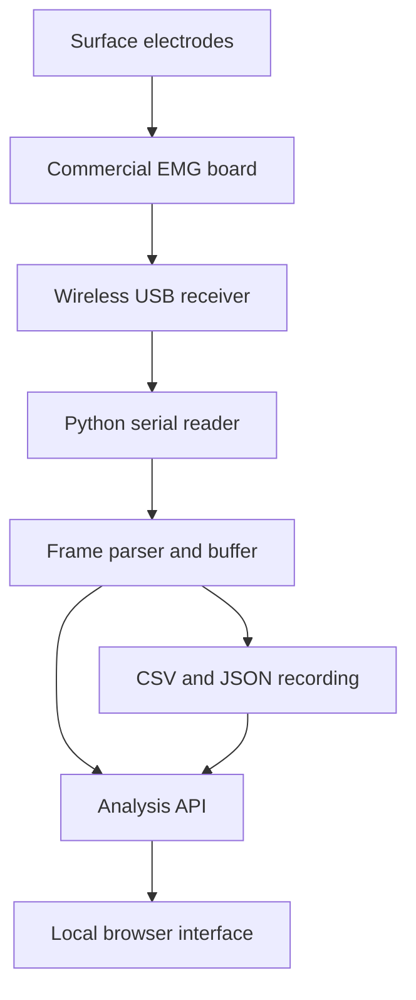

# System architecture

EMG-Lab connects a commercial dual-channel sEMG module to a local macOS application. The engineering contribution is the integration, software workflow, testing, analysis and documentation around the supplied hardware. The board's analog circuit, MCU firmware and wireless protocol are supplied by the manufacturer.

## 1. What belongs to each layer

| Layer | Component | Role | Project contribution |
|---|---|---|---|
| Sensing | Disposable electrodes and leads | Couple surface potentials to the board | Setup, channel assignment, observations and photographs |
| Acquisition | Commercial analog front end and ADC | Amplify, condition and digitize the input | Integrated as supplied; circuit and calibration not redesigned |
| Embedded processing | Manufacturer MCU firmware | Produce eight output fields | Interpreted the documented output; no firmware modification |
| Transport | Board wireless link and USB serial receiver | Deliver text frames to the Mac | Port discovery, serial configuration and receive loop |
| Backend | `server.py` | Parse, buffer, record and analyze data; serve local API | AI-assisted Python implementation directed and tested by the project owner |
| Frontend | `web/index.html`, `web/app.js`, `web/style.css` | Live plots, controls, replay and model results | AI-assisted HTML/CSS/JavaScript interface |
| Reproducibility | `data/`, `scripts/`, `reports/`, `tests/` | Keep source data, regenerate results and check calculations | Experiment documentation, deterministic analysis and software checks |

The manufacturer's public product page describes an analog acquisition stage followed by MCU-based processing. The more detailed serial field mapping comes from the product instructions supplied by the project owner. See [references](REFERENCES.md).

## 2. Acquisition and storage

The serial reader is a background thread. Incoming bytes may contain an incomplete line, a complete line, or several lines. `Framer` retains the incomplete suffix, synchronizes on a newline, validates complete eight-integer frames and counts malformed lines. It discards the first incomplete candidate after a new connection or resynchronization.

`Lab` holds a bounded buffer of the latest 12,000 valid frames. A lock protects shared state between the serial thread and HTTP requests. The host assigns a frame index when a valid frame is accepted. This index is useful for local ordering; it cannot detect frames lost before they reach the parser because the device output has no sequence counter.

Recording is separate from the live plotting buffer. While recording is active, each valid frame is written to CSV, with the original eight numeric fields and a host receipt timestamp. The JSON sidecar records the session label, data source, serial settings, stated sampling-rate basis and event markers. Display centering and filters do not modify the saved device fields.

The bundled historical sessions contain CSV files only. Their original JSON sidecars were not supplied. The new report reconstructs context from the owner's experiment descriptions and marks inferred intervals explicitly; it does not invent missing sidecars or device timestamps.

## 3. Time and provenance

There are three different clocks or indices:

| Quantity | Meaning | Appropriate use |
|---|---|---|
| Host frame index | Order in which valid frames entered this program | Plotting, replay and relative offsets in received frames |
| `host_elapsed_s` | Host monotonic time at receipt of a batch, measured since connection | Approximate session timing and reception-rate summaries |
| Device acquisition time | Not present in the documented stream | Requires additional manufacturer information or measurement |

Several frames received in one batch may share a host timestamp. Recording can start after connection, so the first saved timestamp need not be zero. The report subtracts the first saved timestamp for session-relative plots.

`source_kind` distinguishes a device stream from a synthetic stream in new exports. Provenance is not calibration: a row marked `device` establishes where the program obtained it, not the voltage gain or physical sample rate.

Similarly, an imported CSV marked `synthetic` does not prove a generating rate. The built-in demo/example paths carry the known 300-frame/s simulation rate; arbitrary imported CSVs keep an unknown rate until explicitly configured.

## 4. Browser and backend boundary

The frontend runs in an ordinary browser. It calls a local HTTP API, draws charts and sends configuration choices. Python owns serial-port access and numerical processing. No browser serial extension, remote database, frontend build service or cloud account is required.

The server binds to `127.0.0.1`; it checks expected local Host and Origin headers. It is a local prototype, not an internet-facing service. API details are in [API.md](API.md).

The program reads device frames and does not implement stimulation commands or a stimulator control path. Opening a serial port can still affect ordinary serial control lines depending on the receiver and driver; “read-only” describes the application's intended data use, not a hardware isolation certification.

## 5. Numerical processing

`analyze` extracts the second and sixth fields as the two plotted ADC-like signals. It applies optional displayed-window mean removal and optional analysis filters, then returns summary statistics, sliding RMS, FFT amplitude, Welch PSD and correlation arrays. The browser does not silently relabel counts as volts.

The live view analyzes the latest selected window repeatedly. Its optional forward-backward filtering is an offline calculation on that window. It does not establish a causal, fixed-latency control pipeline. See [METHODS.md](METHODS.md) for formulas and edge behavior.

The regression module uses two RMS features and an intercept. With trial labels, it holds out complete trials; otherwise it uses a chronological split and identifies that limitation. The packaged example is synthetic. Real recordings in `data/raw/` have no independent force target and are not a force-prediction benchmark.

## 6. Two ways to view the project

| Surface | What runs there | What it provides |
|---|---|---|
| Local application | Python plus a browser | Hardware connection, live data, recording, replay and analysis |
| `docs/index.html` | Browser-only HTML/JavaScript | Six bilingual teaching chapters and interactive mathematical models |
| GitHub repository | Files rendered by GitHub | README, photographs, methods, report, source code and data |

GitHub Pages can serve the static notes. It does not run the local Python server or access a visitor's USB receiver. The notes' simulated demonstrations remain labeled as teaching models even though the repository also contains measured data.

## 7. Scope of the contribution

The project owner selected the hardware and objectives, directed AI-assisted implementation, performed Mac integration and hands-on testing, described and performed the self-recorded actions, and iterated on the interface and interpretation. The repository documents this workflow rather than implying original MCU firmware, custom analog hardware, a novel signal-processing algorithm or a clinically validated instrument.

Related documents: [protocol](PROTOCOL.md), [methods](METHODS.md), [limitations](KNOWN_LIMITATIONS.md), [technical report](../reports/TECHNICAL_REPORT.md).
