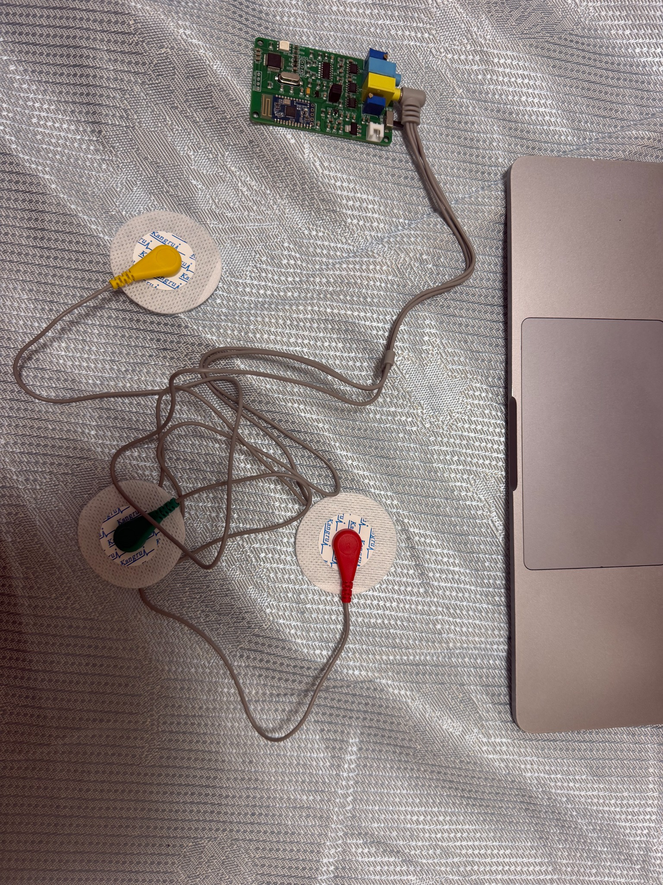
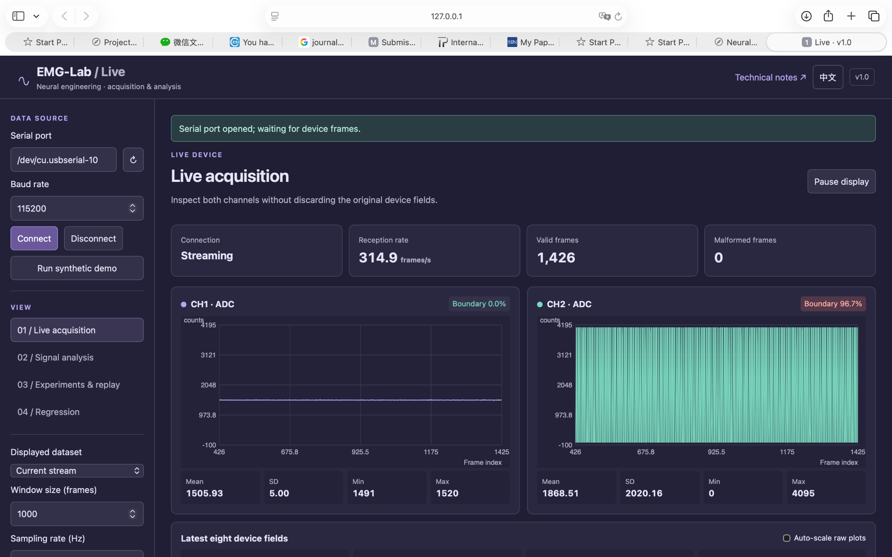
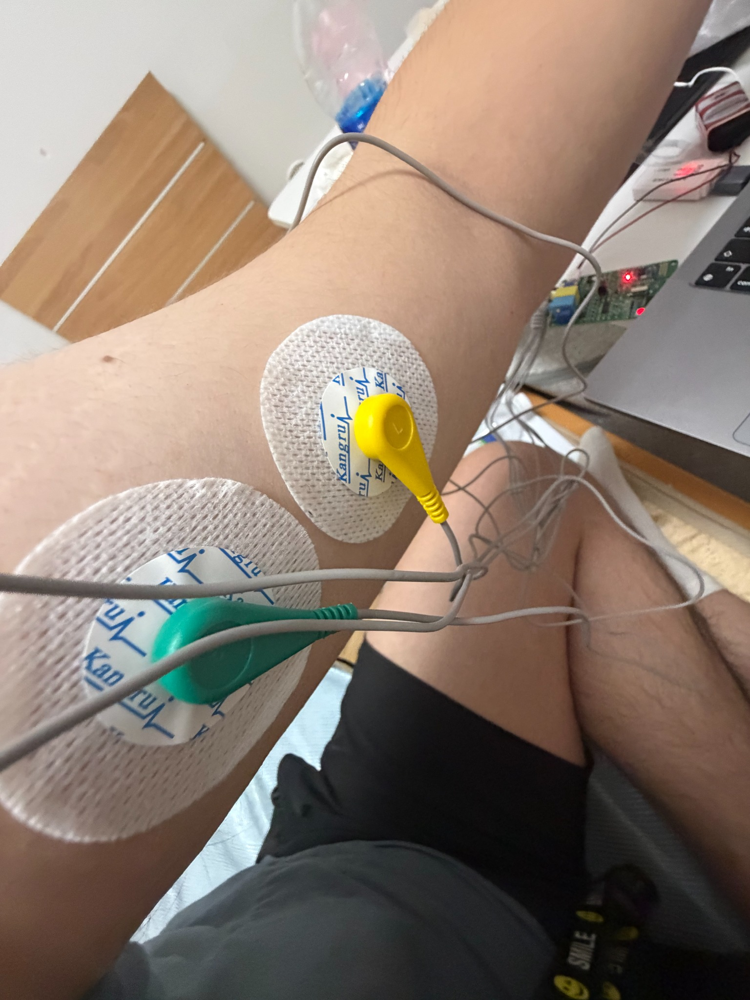
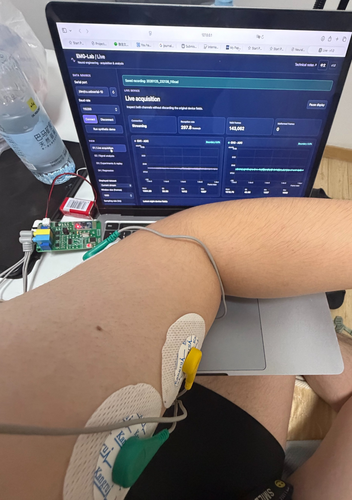
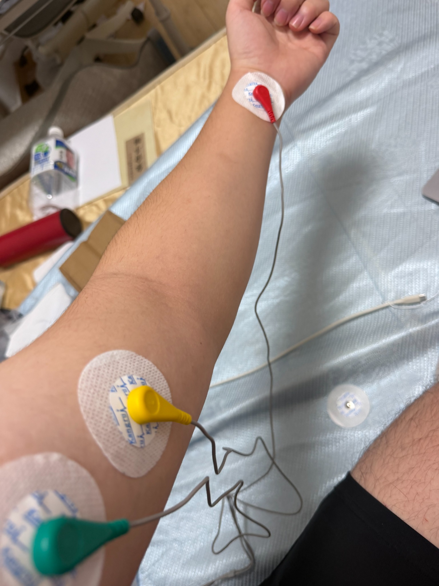
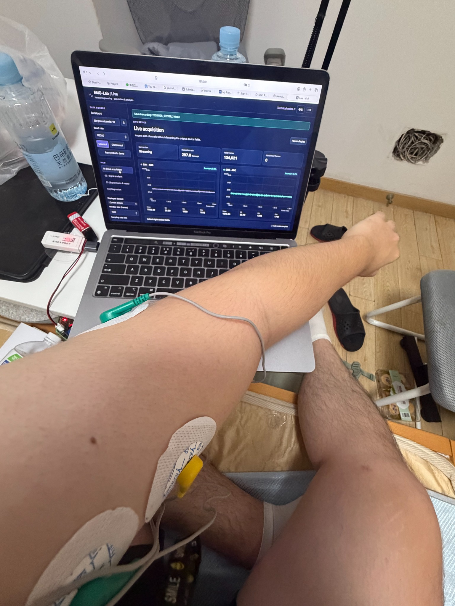

# Illustrated hardware and recording guide

[Project home](../README.md) · [中文首页](../README.zh-CN.md) · [Software controls](QUICKSTART.md) · [Protocol](PROTOCOL.md)

This guide documents the actual components and software workflow used in EMG-Lab. Photographs were supplied by the project author. The body-mounted photographs record historical experiments; electrode spacing, placement and electrical safety were not independently validated in this project.

## 1. The components

<p align="center"></p>

*The commercial acquisition module and one three-electrode lead. The board includes analog acquisition circuitry, a microcontroller and a wireless module. Photo taken with the leads off the body; it does not show the complete powered setup.*

| Component | Role in this project |
| --- | --- |
| Sichiray dual-channel module | Amplifies/conditions the electrode signals and exports manufacturer-defined digital fields |
| One lead per channel | Connects the board's electrode socket to the three clips; two leads were used for the dual-channel session |
| Green and yellow clips | Measurement pair according to the supplied instructions for this particular cable/module |
| Red clip | Reference connection according to the supplied instructions; it is not a muscle stimulation output |
| Battery and matching board connector | Powers the module in the recorded setup |
| Wireless USB receiver | Presents the incoming stream to macOS as a serial device |
| USB-C to USB adapter | Connects the USB receiver to the MacBook Pro |
| Python service and browser | Receives the serial bytes, records data and displays the application locally |

The color mapping is specific to the supplied equipment. The photograph alone cannot establish a 3.5 mm connector pinout or electrical isolation. The vendor material contains both a 4.7–5 V module specification and a 9 V battery-connector instruction; these refer to an unresolved hardware distinction in the supplied information. Confirm the intended connector and board revision with the vendor before changing the power supply. [Protocol and hardware unknowns](PROTOCOL.md).

## 2. Connect the computer

Use the board's documented battery and receiver arrangement. The USB receiver goes into the Mac through the adapter; the electrode lead goes into the module, not into the Mac's audio socket. The board communicates with its paired wireless receiver. This workflow does not require the Windows viewer or a direct Web Bluetooth connection from the browser.

Close applications already using the same serial port, including `screen` or an earlier plotting script. Start the software from the extracted project folder:

```bash
bash run.command
```

The browser opens `http://127.0.0.1:8765/`. In the left sidebar, refresh the port list and select the receiver. The author's observed port was `/dev/cu.usbserial-10`, with baud rate **115200**. Click **Connect** and look at the **Connection**, **Reception rate**, **Valid frames** and **Malformed frames** cards.

To list candidate ports independently on a Mac:

```bash
ls /dev/cu.*
```

A recognized port means the USB serial device is visible. Increasing valid-frame counts confirm that the application is parsing the expected stream. Neither observation establishes that an attached electrode signal is physiologically meaningful.

## 3. Check the signal before interpreting it

The first tests were performed with the leads off the body. These tests separated the communication path from input-quality problems.

| Author-reported 10 s test | CH1 boundary-code occupancy | CH2 boundary-code occupancy | Interpretation |
| --- | ---: | ---: | --- |
| Cable in CH1, clips floating | 90.33% | 0% | The connected floating lead was associated with saturation-like values |
| Both leads removed | 0% | 0% | Both disconnected inputs were relatively quiet |
| Same cable in CH2, clips floating | 0% | 96.83% | The problem followed the cable/input condition |

These three values come from the terminal results supplied by the author; their original 10 s CSV files are not included. The two later 30 s floating-input CSVs **are** included and analyzed in the [report](../reports/TECHNICAL_REPORT.md).



*Historical v1.0 screenshot: the application receives valid serial frames while CH2 is almost entirely at the provisional boundary codes. A working data connection can coexist with unusable measurement data. The old waiting-message banner was later corrected in v1.1.*

For a first inspection use **Digital filter = None** and leave **Sampling rate** blank. Check the raw range, the 0/4095 boundary percentage and the baseline. Filtering cannot recover samples already clipped at a boundary. A quiet disconnected channel also does not prove that it is ready to measure a muscle.

## 4. What was attached during the body recordings

<p align="center"></p>

*Close view of an upper-arm measurement pair during the recorded project. The photograph has no scale and does not establish anatomical placement accuracy.*

The author first recorded a single channel assigned to biceps, then recorded two channels assigned to opposing upper-arm muscles. In the final session, **CH1 = triceps** and **CH2 = biceps**, according to the author's description. These labels are experimental metadata; the CSV itself contains channel numbers, not anatomical labels.

<p align="center"></p>

*The module, leads and Mac interface during the project. The on-screen filename corresponds to the final recording supplied for analysis.*

For any future body-connected work, use equipment and electrode instructions whose suitability has been established for that use. This project's photographs and software checks do not provide that validation. Acquisition and electrical stimulation devices remain separate and must not be simultaneously attached to the body in this workflow.

## 5. Reference locations: the actual record

The author tried different red-reference locations. This is useful to document, because changing reference/contact conditions can change the recording. It is not a controlled comparison of reference sites.

| Session | Reported reference location | Other relevant facts |
| --- | --- | --- |
| Early single-channel attempt | Wrist | Heavy narrowband interference and 0/4095 occupancy were present |
| Later single-channel attempt | Knee | The author also changed to stronger voluntary contractions; several factors changed together |
| Final dual-channel session | Forehead | Five intended actions, each repeated twice; both channels were used |

<p align="center"></p>

*An earlier wrist-reference setup. This photograph illustrates the history of the experiment, not a universal placement rule.*

The observation “the later recording looked better” should be retained alongside the changes that occurred. It does not establish “forehead or knee is the best reference,” nor that every wrist location necessarily causes interference. Electrode contact, movement, cable fixation, the selected muscle, posture and acquisition circuit all matter. Manufacturer instructions and application-specific surface EMG guidance should inform a future controlled setup. [Primary references](REFERENCES.md).

## 6. The five recorded actions

The author reported the following order, with each condition repeated twice consecutively and approximately five seconds of rest between efforts:

| Condition | Elbow/arm description | Intended effort |
| --- | --- | --- |
| C1 | Neutral arm position | Biceps and triceps together |
| C2 | Extended elbow | Biceps and triceps together |
| C3 | Extended elbow | Triceps emphasis; attempted biceps relaxation |
| C4 | Flexed elbow | Biceps and triceps together |
| C5 | Flexed elbow | Biceps emphasis; attempted triceps relaxation |

<p align="center"></p>

*An extended-arm photograph from the session. The photograph is not time-locked to a specific event interval and does not establish which muscles were active.*

The script reconstructs activity intervals from the recording and assigns the author's reported order to them. It does not treat these labels as independent proof of isolated recruitment. For definitions and the exact interval table, see the [technical report](../reports/TECHNICAL_REPORT.md).

## 7. Record, save and replay

In **03 / Experiments & replay**, enter an experiment label, click **Start recording**, add descriptive markers when relevant, then click **Stop recording**. The app saves a CSV and a JSON sidecar in `recordings/`. The JSON stores the settings and host event labels. These event times are not synchronized device triggers.

Keep both files together for future sessions. The five historical CSVs bundled here were supplied without their original JSON sidecars, so no missing precise event log has been invented.

Use **Import & replay** to open a saved CSV. Set the displayed dataset to the imported file and inspect it in **Signal analysis**. Replay can be performed with the device disconnected. It is an illustrative scan of stored frames, not reconstruction of the hardware acquisition clock.

## 8. Common problems

| Observation | First check |
| --- | --- |
| No serial port | Receiver/USB-C adapter connection, then refresh the list |
| Port busy | Close the other program that opened it |
| Connected, no valid frames | Board power, receiver link and the selected port/baud |
| Many malformed frames | Confirm 115200 and the exact eight-field protocol; preserve the observation before analysis |
| Many values at 0 or 4095 | Input/lead/contact conditions and saturation; do not interpret the amplitude as muscle strength |
| A strong narrow spectral peak | Treat it as a signal-quality question; inspect normalized-frequency spectra and timing assumptions |
| Regression refuses a real CSV | The supplied recording lacks an independently measured numeric target; use the labeled synthetic example to inspect the modeling workflow |

## 中文速读

电脑接的是**无线 USB 接收器**；肌电板接的是**厂家配套电极导联和指定电池接口**。网页只是本地 Python 程序的界面，启动命令是 `bash run.command`。

先看左侧串口与 `115200` 波特率，再看有效帧是否增加。分析页默认去均值、无滤波、RMS 60 帧，采样率留空。数据能进来和信号质量合格是两件要分别检查的事。

照片与表格把实际尝试过的贴法写清楚，但不把“红电极贴膝盖或额头”写成通用教程。后来的质量改善同时伴随了其他变化。对这份项目而言，最有用的贡献是完整保留装配、排障、记录和解释过程。
