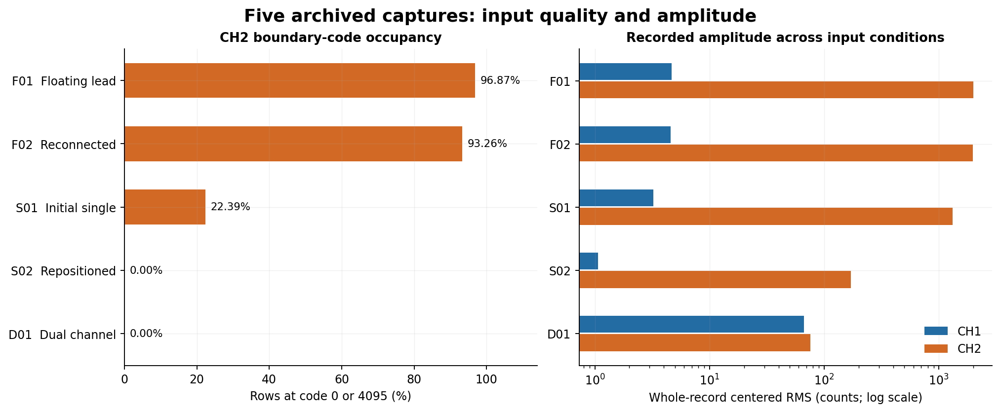
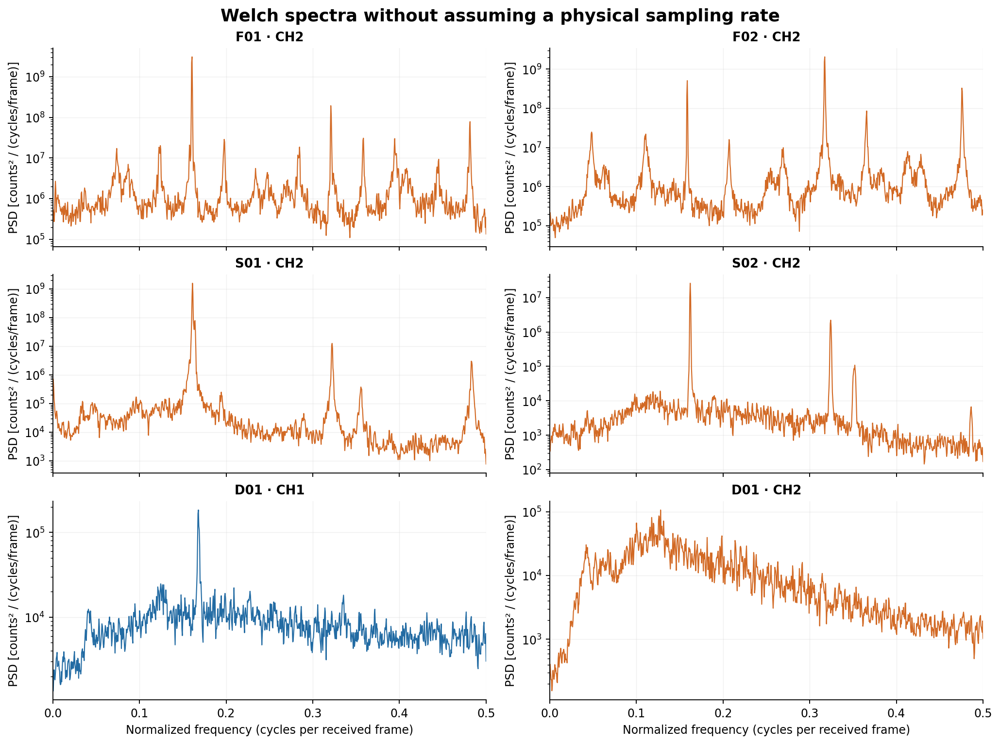
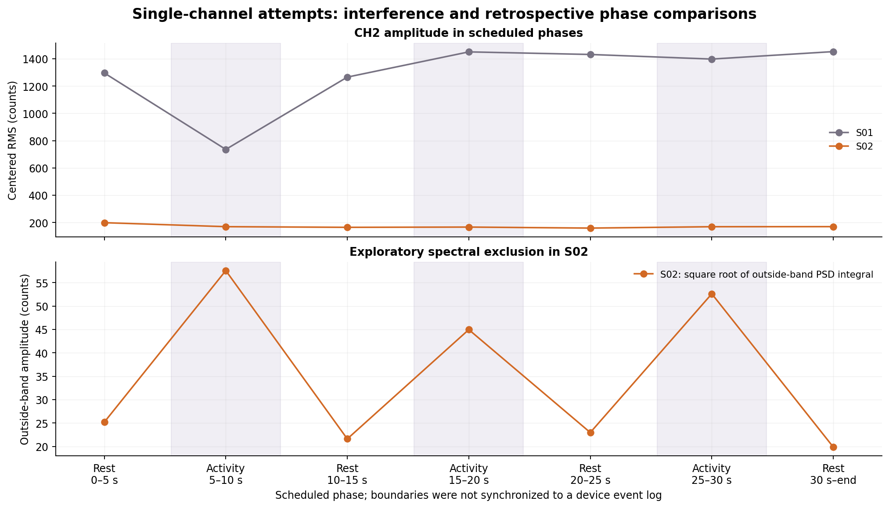
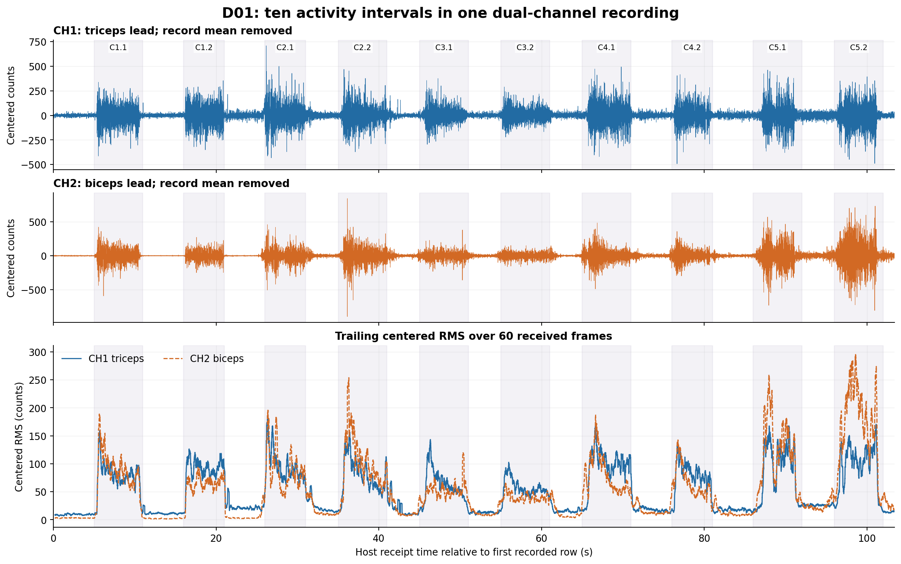
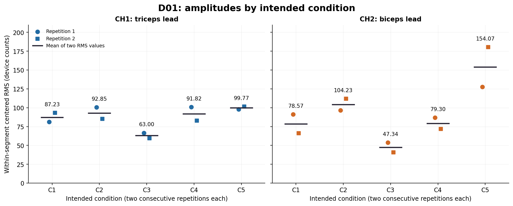

# EMG-Lab: a macOS interface for dual-channel surface EMG acquisition and exploratory analysis

**Jincheng Li (李锦承)**  
Independent engineering project · November 2026 · Release 1.1

[Project overview](../README.md) · [Recorded data](../data/README.md) ·
[Recomputed tables](RESULTS.md) · [Analysis script](../scripts/analyze_recordings.py)

## Abstract

EMG-Lab connects a commercial dual-channel surface electromyography module to a
local macOS application. The project combines a Python serial-acquisition and
analysis backend, an HTML/CSS/JavaScript interface, and interactive technical
notes. It uses the manufacturer's published eight-field serial protocol to
receive channel data without relying on the Windows plotting application. The
author selected and connected the hardware, directed AI-assisted software
implementation, tested the program on a Mac, investigated input-quality problems,
and collected exploratory self-recordings.

The archived evidence contains five CSVs and 71,287 received frames. Floating
electrodes produced extensive boundary-code occupancy, and the first biceps
attempt contained strong narrowband structure and clipped values. A later
single-channel attempt removed the observed boundary occupancy, although
narrowband interference remained. The final dual-channel capture contains 30,835
frames over a 103.37-second host-time span. It shows ten activity intervals
corresponding in order to five author-reported voluntary activation conditions,
each attempted twice. This report documents the software workflow, numerical
methods, observations and reproducibility limits. It demonstrates an implemented
hardware-to-data workflow with exploratory measurements; it does not establish
calibrated force estimation or a physiological benchmark.

### 中文提要

这个项目的核心成果，是把现成双通道肌电模块接到 Mac 上，自行组织一个 Python
后端和 HTML 前端，完成实时显示、存档、回放及统计分析，再用真实自采数据检查它。
本报告保留五份原始导出文件，并提供一条命令即可重算的脚本。最终双通道记录能够
看到十段活动，对应五种有意进行的动作各两次。这里的“二头肌单独发力”等名称描述
实验者的意图，不能直接当成另一块肌肉完全静止的证据。膝盖和额头的参考电极位置
是实验历史记录，不作为已经验证的通用操作建议。

## 1. Engineering objective and contribution

The immediate problem was practical: the supplied tutorial described a Windows
application, while the author wanted to acquire and inspect the module's data on
a MacBook Pro. The board already performed amplification, analog-to-digital
conversion and some firmware processing. Its published serial format provided a
way to build another host interface.

The project scope was host-side hardware integration and analysis. The work did
not include designing a new microcontroller, analog front end or board firmware.
The module, electrode leads and wireless receiver were purchased components.
The author's contribution included selecting the workflow, specifying features,
directing AI-assisted implementation, carrying out serial and physical setup
tests, reporting failures, changing the experimental setup, and interpreting the
data with reproducible calculations.

The delivered software provides live plotting, reception diagnostics, all eight
device fields, session CSV export, offline import and replay, event annotation,
amplitude and spectral features, correlation analysis, and a supervised-regression
demonstration on a separately labeled synthetic dataset. The source code and
[verification record](../TEST_STATUS.md) distinguish numerical tests, user-run
hardware checks and properties that remain unmeasured.

## 2. System and signal path

The tested acquisition path consisted of surface electrodes, the commercial
dual-channel module, its wireless receiver, the Mac's serial interface and the
local Python process. The browser displayed data served by that process. A USB-C
adapter connected the receiver to the Mac; the observed device path was
`/dev/cu.usbserial-10`, with the serial baud rate set to 115200.

Each received frame contains eight comma-separated integer fields. Four belong
to each channel: a manufacturer-named mean, a lightly filtered ADC value, a
power-like value and an effort-level value. Analysis in this report uses
`ch1_adc` and `ch2_adc`. The full eight-field exports are retained so that those
choices can be reviewed. See the [data dictionary](../data/README.md) and
[methods documentation](../docs/METHODS.md).

The host program adds a sequential frame index and receipt timestamps. Neither
is a hardware acquisition timestamp. All five CSVs contain repeated adjacent
host timestamps, and the final record begins at `host_elapsed_s = 80.183575`.
This report subtracts that first timestamp when displaying elapsed recording
time. It does not change the original CSV.

Several device properties remain unknown: actual sampling schedule, the relation
between exported frames and ADC conversions, gain, voltage calibration, effective
analog and firmware bandwidth, and channel timing. The manufacturer-described
ADC conversion time is insufficient to establish the exported sample rate.
Therefore, values stay in device counts and spectral axes use cycles per received
frame. A measured reception rate is reported as a transport observation.

## 3. Evidence and recording inventory

The [data inventory](../data/README.md) links all five files. SHA-256 hashes and
byte sizes in [summary.json](../data/derived/summary.json) identify the exact
original inputs. The files contain one participant's exploratory self-recordings
and bench measurements from one session; recordings are not independent study
participants.

| Record | Intended context | Rows | Host span (s) | Received frames/s |
| --- | --- | ---: | ---: | ---: |
| F01 | Floating CH2 cable | 9,387 | 30.13 | 311.53 |
| F02 | Same wiring, after reconnect | 9,572 | 30.38 | 315.02 |
| S01 | Initial biceps recording on CH2 | 10,817 | 34.95 | 309.44 |
| S02 | Biceps, reference repositioned and effort increased | 10,676 | 34.63 | 308.26 |
| D01 | CH1 triceps and CH2 biceps | 30,835 | 103.37 | 298.29 |

The rate convention is `(N − 1) / (last host time − first host time)`. It counts
intervals between received rows. Earlier terminal tests used a stopwatch and
`N / duration`, so those printed rates need not equal this calculation exactly.
The exported `frame` index is continuous in each file, and every `source_kind`
value is `device`. Since the host assigns the index after receiving data,
continuity does not establish that no hardware samples or wireless packets were
lost. There is no device packet counter in the supplied protocol.

The original session JSON sidecars and synchronized event markers were not
provided with these files. Condition labels and reference-electrode locations
come from the author's account. Retrospective segmentation is disclosed below
rather than represented as recorded event ground truth.

## 4. Reproducible analysis

### 4.1 Amplitude and boundary occupancy

For any selected segment containing values $x_1,\ldots,x_n$, the report computes

$$
\bar{x}=\frac{1}{n}\sum_i x_i,
\qquad
A=\sqrt{\frac{1}{n}\sum_i(x_i-\bar{x})^2}.
$$

Thus the reported **centered RMS** equals the population-normalized standard
deviation of that segment. Centering removes its DC offset. It is not the RMS of
the uncentered values near 1500 counts. No conversion to millivolts, newtons or
percentage of maximum voluntary contraction is applied.

Boundary occupancy is the fraction of values equal to 0 or 4095. These observed
codes are useful provisional saturation indicators. They do not independently
prove the ADC's physical resolution or detect every form of clipping. The absence
of these codes also does not establish that a signal is free of interference.

### 4.2 Spectra and timing

The script uses Welch PSD estimation with a Hann window, up to 2048 frames per
segment, 50% overlap, constant detrending and `fs = 1`. The resulting frequency
unit is cycles per received frame. PSD units are counts² per cycles/frame. These
are descriptive spectra of the received sequence; physical-frequency
interpretation would require a justified sampling model.

For the single-channel phase illustration, Welch segments contain up to 1024
frames. A selected full-record peak $f_0$ and its second harmonic $2f_0$ define
two excluded bands with halfwidth 0.005 cycles/frame. The reported outside-band
amplitude is

$$
A_{\mathrm{outside}}=
\sqrt{\sum_{f_j\notin B}\widehat{P}(f_j)\,\Delta f}.
$$

This is the square root of selected PSD area. It is not an inverse-FFT
reconstruction or a time-domain filtered RMS. The bands were selected after
looking at the data. Removing those bins can remove physiological signal as well
as interference, and residual power can still include artifacts.

### 4.3 Activity selection and condition summaries

For D01, the script divides the re-zeroed host-time axis into one-second bins,
centers each channel within each bin, and marks a bin if either channel's RMS
exceeds 45 counts. Merging consecutive marked bins produces ten intervals:

`5–11, 16–21, 26–31, 35–41, 45–51, 55–61, 65–71, 76–81, 86–92, 96–102 s`.

This threshold is a retrospective descriptive choice. It makes the plotted
boundaries reproducible but does not yield independent activation labels. The
author's reported condition order assigns two consecutive intervals to each
condition. The condition summary averages the two repetition-level centered RMS
values with equal weight. It does not pool all their samples before taking RMS.

For context, each activity interval is compared with a preceding window
`[start − 3.5 s, start − 0.5 s)`. No significance test is performed: selection is
based on the observed signal, repetition counts are small, and all observations
come from one ordered session.

The time-series figure also shows a 60-frame trailing centered RMS, centering
within each trailing window. Only complete windows are plotted. This reporting
calculation differs from the live app option that subtracts the displayed
window's mean before computing its RMS trace.

## 5. Observations

### 5.1 Floating electrodes reveal an input-quality problem



F01 and F02 have CH2 boundary occupancy of **96.87%** and **93.26%**, respectively.
Their centered RMS values are approximately 1995 and 1989 counts. Meanwhile,
CH1, which was unused in those captures, remains near 1505 counts with a standard
deviation below five counts. This pattern is consistent with a floating-input or
interference problem associated with the connected cable. It does not isolate
the electrical mechanism or prove a hardware defect.

The author reported reconnecting the application between those two captures and
otherwise leaving the intended wiring unchanged. The distributions and spectra
changed, but the records do not establish that reconnecting caused that change.
Contact, environmental interference and other unlogged conditions were not
controlled. A stable unconnected input should not be interpreted as a quiet
muscle measurement.

### 5.2 First biceps attempt: large amplitude was not sufficient evidence

S01 has CH2 values from 0 to 4095, **22.39%** boundary occupancy and a centered RMS
of 1313.26 counts. A dominant narrowband component appears at approximately
0.16113 cycles/frame. Under an additional, unverified assumption that the
reception rate equals uniform sample rate, this would be near 50 Hz. The report
therefore treats mains-related contamination as a plausible explanation, not a
measured physical-frequency identification.

The proposed experiment alternated five seconds of rest and five seconds of
voluntary contraction for approximately 35 seconds. With those assumed
boundaries, unfiltered segment amplitudes do not provide a clear
rest–contraction pattern. Clipping and strong periodic structure make this
record unsuitable for a clean physiological interpretation. The report retains
it as a useful failed acquisition attempt.

### 5.3 Reference repositioning and stronger effort: a changed signal

For S02, the author reported moving the red reference electrode to the knee and
contracting more strongly. CH2 ranges from 991 to 2021 counts with **0% observed
boundary occupancy**, and centered RMS falls to 171.36 counts. The signal is no
longer hitting the two provisional boundary codes, although its spectrum still
contains strong narrow peaks.



The two selected narrow bands account for **93.94%** of S02's full-record Welch
power under the stated settings. For the planned five-second phases, the average
outside-band amplitude is **22.41 counts during nominal rest** and **51.73
counts during nominal activity**, a ratio of **2.31**. The calculation uses an
equal-weight mean of four rest-phase and three activity-phase amplitudes.



Changing the excluded-band halfwidth from 0.003 to 0.015 cycles/frame gives
activity/rest ratios between **2.22 and 2.29**, with 2.31 at the main 0.005 setting.
This supports a descriptive observation of activity-associated amplitude in
these retrospectively defined phases. It does not prove that the residual is
pure muscle activity. It also cannot establish that the knee reference caused
the improvement: reference location and effort both changed, with contact and
posture also insufficiently documented for a controlled comparison.

### 5.4 Dual-channel recording: five intended actions, two repetitions each

In D01, the author placed CH1 over the triceps and CH2 over the biceps, reported a
forehead reference, and attempted the following actions in order. Each action
was performed twice, with approximately five seconds of rest between attempts.

| Label | Intended action | Repetitions |
| --- | --- | --- |
| C1 | Neutral arm position, both muscles intentionally active | 1–2 |
| C2 | Extended elbow, both muscles intentionally active | 3–4 |
| C3 | Extended elbow, triceps effort with intended biceps relaxation | 5–6 |
| C4 | Flexed elbow, both muscles intentionally active | 7–8 |
| C5 | Flexed elbow, biceps effort with intended triceps relaxation | 9–10 |



The 103.37-second recording contains ten clear activity intervals under the
stated retrospective rule. CH1 ranges from 1011 to 2213 counts and CH2 from 620 to
2363 counts. Neither channel contains 0 or 4095. Both channels' amplitudes are
higher in the selected activity intervals than in their preceding comparison
windows. Selection on amplitude means this is a descriptive acquisition check,
not an unbiased hypothesis test of activity detection.



| Intended condition | CH1 triceps lead, mean centered RMS | CH2 biceps lead, mean centered RMS |
| --- | ---: | ---: |
| C1: neutral, both active | 87.23 | 78.57 |
| C2: extended, both active | 92.85 | 104.23 |
| C3: extended, triceps intended | 63.00 | 47.34 |
| C4: flexed, both active | 91.82 | 79.30 |
| C5: flexed, biceps intended | 99.77 | 154.07 |

Values are device counts. The two repetitions are shown individually in the
figure; no error bar is presented as a population confidence interval. The CH2
mean amplitude in C5 is **3.25 times** that in C3. Trimming 0.25 or 0.5 seconds
from both edges of the same intervals gives ratios of **3.32** and **3.46**.
This contrast is visible within the recorded sequence and is not an estimate of
generalizable muscle strength or classification accuracy.

The intended selective conditions still show activity in both channels. Possible
contributors include actual co-contraction, crosstalk, posture-related movement,
reference contamination and other shared artifacts. The two channels have not
been calibrated to a common physiological scale, so their absolute counts cannot
be read as which muscle produced more force. Negative waveform correlation, if
computed in the app, would also not by itself establish antagonistic motor
control.

### 5.5 Manufacturer summary fields require caution

In D01, `ch1_mean` is constant at 1502, `ch2_mean` is constant at 2480,
`ch1_level` stays at zero and `ch2_level` ranges from 0 to 255. These values do not
behave like straightforward current means and calibrated force. The report
therefore preserves them as opaque manufacturer fields and computes explicit
features from the two channel-value columns. All field ranges are available in
the JSON summary.

## 6. What the evidence supports

The project shows that the selected module can feed a custom Mac workflow, that
its received fields can be recorded and replayed, and that the resulting files
can support repeatable signal-quality checks and descriptive analysis. The
archive includes difficult input conditions as well as the final visually clear
activity recording. This makes the engineering process inspectable beyond a
single selected screenshot.

The evidence also illustrates a useful analysis lesson: large RMS alone does not
identify a good muscle recording. F01, F02 and S01 have much larger amplitudes
than D01 because their received sequences include severe boundary occupancy or
periodic contamination. Input quality, baseline handling and context must be
considered before interpreting a feature physiologically.

The strongest supported experimental statement is that one dual-channel
self-recording shows activity-associated amplitude differences across ten
ordered attempts with author-reported intended actions. There are no measured
force targets, randomized condition orders, independent sessions or held-out
participants in this archive. The application includes regression functionality,
but its supplied supervised example is synthetic and separate from these
recordings. No real-data force-prediction score is claimed here.

## 7. Limits and useful next measurements

The main remaining measurement limits are the physical sampling schedule,
front-end gain and bandwidth, channel timing, and calibration. A known test
signal and manufacturer clarification could address those issues. Exact
electrode spacing, local reference placement, posture and contact preparation
would need to be recorded consistently for a controlled physiological study.
Device human-use electrical safety has not been established by these files.

The historical knee and forehead reference placements are recorded for
traceability. Their effect cannot be separated from other changes. They should
not be promoted as a universal better location, and these exploratory recordings
do not provide an instruction to reproduce head placements or combine recording
with stimulation.

For future research, an independently measured target and synchronized event
labels would make more informative analyses possible. Additional sessions and
participants would be needed before estimating generalization. These are future
extensions; they are not prerequisites for presenting the current system as a
completed independent engineering demonstration with clearly bounded evidence.

## 8. Reproduce and inspect

From the repository root:

```bash
python3 -m pip install -r requirements-analysis.txt
python3 scripts/analyze_recordings.py
```

The script reads the five unchanged CSVs and regenerates seven derived CSVs,
`summary.json`, the numerical appendix, and five figures in PNG and SVG form.
It uses no random resampling. [RESULTS.md](RESULTS.md) lists the full interval,
timestamp, phase and sensitivity results. [summary.json](../data/derived/summary.json)
records full-precision values, software versions, script hash and input hashes.
Minor floating-point or plot-rendering differences can occur with other library
versions.

The raw exports remain the evidence. Figures summarize them, author-reported
context supplies condition intent, and the script defines the transformations.
This separation allows another reader to inspect the engineering result and
recompute the stated observations.

## References and evidence sources

1. [Original recording inventory and data dictionary](../data/README.md).
   The five author-supplied CSVs are the source for all numerical observations.
   Electrode locations and intended condition order are author-reported metadata.
2. [Sichiray dual-channel EMG sensor product information](https://www.sichiray.com/portfolio/items/emg-sensor).
   The product page describes acquisition, amplification and filtering, analog
   outputs, and MCU processing. The full eight-field protocol used here came from
   the product documentation supplied in the project conversation.
3. [SciPy: `scipy.signal.welch`](https://docs.scipy.org/doc/scipy/reference/generated/scipy.signal.welch.html).
   API reference for the PSD estimator used by the reproducible analysis script.
4. [Project methods](../docs/METHODS.md) and
   [reference notes](../docs/REFERENCES.md).
   These document application algorithms, source coverage and the limits of
   interpreting device fields and electrode placement.
